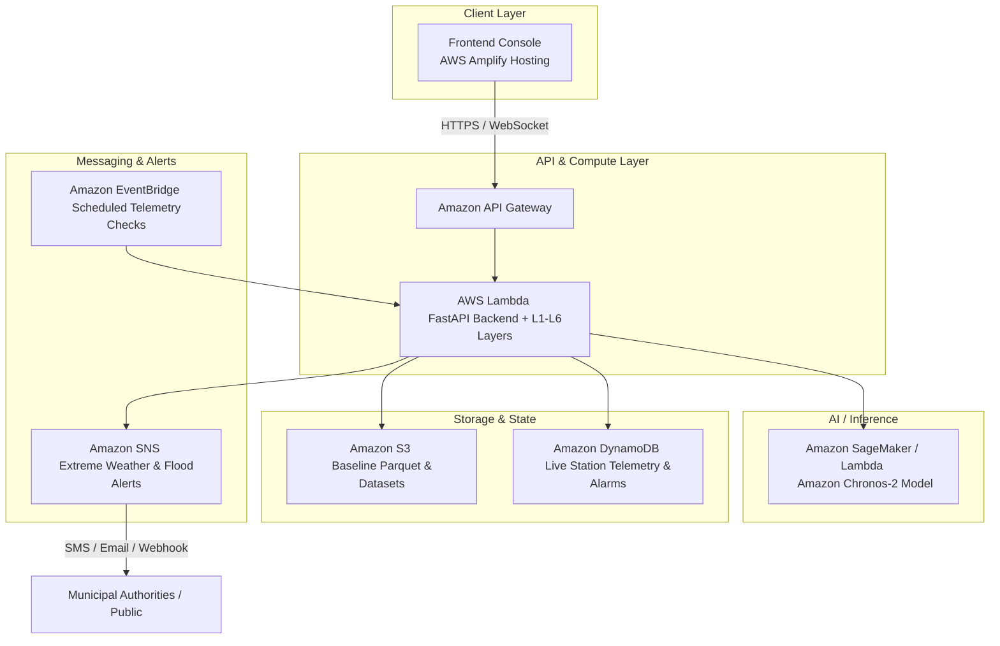

# SkyGuard AI: Current State Audit, Environmental Hacks Mapping, Architecture Roadmap, Demo Script, and Positioning

## 1. Current State Audit

### What exactly has already been built?
The repository contains a fully runnable Python and JavaScript backend/simulation stack (`microservices/app/`) engineered for real-time Automatic Weather Station (AWS) data streaming, physics checks, machine learning anomaly detection, zero-shot forecasting, and a real-time web console dashboard (`microservices/frontend/index.html`).
- **Core Engine & Streaming (`microservices/app/backend.py`):** A FastAPI server that connects to a local sensor simulation stream (`microservices/app/sensor_simulation/main.py`), steps through streaming records tick-by-tick, runs multi-layer evaluations, tracks sensor health, drift, and aging, and broadcasts live WebSocket state to connected frontends.
- **Microservices & Layer Architecture (`microservices/app/layers_v2/`):** A structured, modular implementation of 6 distinct anomaly detection and data quality layers:
  - `physics.py` (L1): Checks physical bounds, rate-of-change, Magnus formula saturation, dew-point depression, and mean-sea-level pressure consistency.
  - `ml.py` (L2): Isolation Forest with SHAP explainability.
  - `frozen.py` (L3): Identifies flatline/stuck sensor readings (sensor freeze).
  - `forecasting.py` (L4): Zero-shot multivariate forecasting via `amazon/chronos-2` corridor checks (p5/p50/p95).
  - `spatial.py` (L5): Peer-station spatial agreement using Haversine distance and robust Z-scores with elevation-adjusted temperature lapse rates.
  - `fusion.py` & `aging.py` (L6 / System Health): Multilayer fault-versus-weather fusion and long-term sensor calibration drift tracking.
- **Interactive Dashboard (`microservices/frontend/index.html`):** A dark-themed, highly polished operator console featuring real-time telemetry charts, anomaly feeds, station metadata panels, streaming speed controls, and layer-by-layer breakdown grids.

### What is the intended user flow?
1. **Simulation Ingest:** The `sensor_simulation` service loads clean baseline meteorological data (`aws_clean_baseline.parquet`) and streams NDJSON events (normal or injected with anomalies) over HTTP.
2. **Real-time Pipeline Processing:** The `backend` service consumes the stream, executes the cascade of anomaly detection checks, computes rolling sensor health scores, and updates memory state.
3. **Operator Monitoring:** Users open the live dashboard (`index.html`) via FastAPI, viewing real-time sensor streams, active alarms, SHAP feature importances, and multi-layer consensus verdicts.

### What data does it ingest?
- **Readings:** Timestamp, station ID, temperature (`temp_c`), pressure (`pressure_hpa`), and relative humidity (`humidity_pct`).
- **Metadata:** Station latitude, longitude, and elevation (`elevation_m`).
- **Source Files:** Parquet datasets stored under `microservices/seeds/data/raw/` and evaluation parquets under `microservices/seeds/`.

### What ML/anomaly-detection methods are used?
- **Deterministic Bounds & Physics (L1, L3, L5):** Tukey fences, MAD (Median Absolute Deviation), Magnus formula saturation curves, barometric pressure lapse formulas, and elevation-corrected Haversine spatial peer comparison.
- **Unsupervised ML & Explainability (L2):** Isolation Forest models trained on temporal rolling features, augmented with SHAP values to isolate root-cause feature anomalies.
- **Deep Zero-Shot Forecasting (L4):** Amazon Chronos-2 (`amazon/chronos-2`) multivariate probabilistic forecasting yielding p5/p50/p95 prediction corridors.
- **Decision Fusion (L6):** Rule-based consensus combining physical constraint failures, ML outlier flags, spatial consensus, and historical sensor aging.

### What outputs/alerts/dashboards exist?
- **Unified JSON Payloads:** Standardized dict payloads across all layers (`predicted_anomaly`, `checks`, `affected_sensors`, `reason`).
- **WebSocket Broadcasts:** Real-time push of station updates and telemetry ticks to the frontend console.
- **Dashboard UI:** A complete single-page application (`microservices/frontend/index.html`) displaying station health status, anomaly streams, and sparkline charts.

### What is working, partially working, missing, or broken?
- **Working:** FastAPI backend, sensor simulator stream, multi-layer Python evaluation scripts, and the frontend dashboard console.
- **Partially Working:** Chronos-2 model integration (requires local Hugging Face model download and sufficient memory/compute).
- **Missing / Needs Integration:** Native cloud deployment scripts, AWS service hooks (S3, DynamoDB, Lambda, API Gateway, EventBridge), and user authentication.
- **Broken / Placeholder:** The `backend/` CommonJS directory (Express/Mongoose prototype) is an incomplete stub and should be bypassed in favor of the fully functional Python FastAPI backend (`microservices/app/backend.py`).

### What technologies/frameworks are used?
- **Python:** FastAPI, Uvicorn, Pandas, NumPy, Scikit-learn, Shap, PyArrow, Accelerate, `amazon/chronos-2`.
- **Frontend:** Vanilla HTML5, CSS3, JavaScript (ES6+), WebSockets.
- **Data Stores:** Parquet files (`.parquet`).

### Is it currently deployable?
Locally, yes (`uvicorn backend:app --port 3000` alongside the sensor simulation). In the cloud, no containerization (`Dockerfile`) or serverless configuration (`template.yaml` / SAM / CDK / Terraform) exists yet.

### What are the biggest technical risks?
- **Model Dependencies:** `amazon/chronos-2` requires significant download bandwidth and inference memory (GPU/CPU overhead during cold start).
- **Architecture Mismatch:** The backend relies on an in-memory generator loop streaming from a local parquet file rather than event-driven cloud queues (SQS/EventBridge) and durable storage (DynamoDB/RDS).

### What parts can be reused without modification?
- Entire `microservices/app/layers_v2/` package (L1 through L6).
- `microservices/app/sensor_simulation/` service.
- `microservices/frontend/index.html` dashboard.
- Core telemetry processing logic in `microservices/app/backend.py`.

---

## 2. Mapping to Environmental Hacks: Track Selection

### Best Track: **Heat and Water**
#### Why this track is the strongest fit
SkyGuard AI's core capabilities directly address extreme weather anomalies, meteorological sensor failures during crisis events, barometric pressure anomalies preceding cloudbursts/floods, and temperature spikes indicating urban heat islands or heatwave emergencies. By framing AWS station anomaly detection as a **Climate Resilience & Extreme Weather Early Warning System**, it targets floods, droughts, monsoon waterlogging, and heatwaves with direct societal impact.

#### Alternative Narrative Rankings
1. **Track 2: Heat and Water (Top Pick):** Extreme heatwave and flash-flood/monsoon early warning system utilizing AWS meteorological telemetry.
2. **Track 1: Air:** Urban air quality monitoring station quality control and pollution sensor drift correction (using temperature/humidity proxies).
3. **Track 3: Waste and Energy:** Microgrid rooftop solar weather forecasting and generation anomaly detection.

---

### Product Narrative: **ClimateShield AI — Extreme Weather & Flash Flood Early Warning Network**

- **Environmental Problem Solved:** Flash floods, cloudbursts, and extreme heatwaves strike vulnerable regions without warning when unattended or faulty weather stations report erroneous or missing data, blinding disaster response teams.
- **Target User:** State Disaster Management Authorities (SDMA), municipal water boards, agricultural meteorologists, and local communities.
- **Core User Journey:** 
  1. Automated ingestion of weather station telemetry from vulnerable river basins/urban zones.
  2. Multi-layer AI pipeline flags sensor hardware dropouts versus legitimate extreme weather surges (e.g., sudden pressure drops indicating cloudbursts).
  3. Real-time spatial peer comparison (L5) confirms if a temperature spike is localized heatwave or sensor failure.
  4. Automated emergency alerts triggered via AWS SNS/EventBridge to municipal response teams.
- **Data Inputs:** Temperature, relative humidity, barometric pressure, elevation, and historical baseline climatology.
- **AI/ML Role:** Isolation Forest outlier detection, SHAP root-cause explainability, and Amazon Chronos-2 zero-shot probabilistic forecasting corridors to detect sudden microclimate anomalies.
- **AWS Services Used:** Lambda, API Gateway, S3, DynamoDB, EventBridge, SNS, Amplify Hosting, SageMaker AI.
- **Demo Scenario:** Simulating an extreme monsoon cloudburst in a river basin where barometric pressure plummets and rainfall/humidity surge, while an adjacent station's sensor malfunctions (freezing). The AI separates real catastrophe from sensor failure and fires an automated flash-flood alert.
- **Why Judges Should Care:** Directly addresses climate adaptation and disaster resilience using advanced zero-shot foundation models (`chronos-2`), robust physics validation, and visible, scalable cloud-native AWS architecture.

---

## 3. AWS Integration Roadmap

### Recommended Serverless Architecture
To ensure low cost, high reliability, and an easy hackathon demo, we adopt a 100% serverless AWS architecture:
- **Frontend Hosting:** AWS Amplify Hosting (hosts `microservices/frontend/index.html`).
- **API & Compute Layer:** AWS Lambda + Amazon API Gateway (containerized or packaged Python FastAPI backend handling ingestion and evaluation).
- **Authentication:** Amazon Cognito (optional for operator login; public demo bypass supported).
- **Data Storage:** Amazon S3 (baseline parquet files and model checkpoints) + Amazon DynamoDB (live station states and anomaly logs).
- **Scheduled Jobs:** Amazon EventBridge (triggers hourly batch spatial checks and data syncs).
- **Real-time Alerts:** Amazon SNS / Amazon SQS (dispatches flood/heatwave alerts).
- **Monitoring & Logging:** Amazon CloudWatch (logs Lambda execution and error metrics).

### Mapping Existing Code to AWS
| Existing Component | AWS Target Service | Integration Action |
|---|---|---|
| `microservices/frontend/index.html` | AWS Amplify Hosting | Deploy static assets directly via Amplify console or CLI. |
| `microservices/app/backend.py` (FastAPI) | AWS Lambda + API Gateway | Wrap FastAPI using `Mangum` adapter or run as a containerized Lambda function. |
| `microservices/app/layers_v2/` | Lambda Layer / Lambda Function | Execute evaluation logic inside serverless functions. |
| `microservices/seeds/data/raw/*.parquet` | Amazon S3 | Store baseline data files in an S3 bucket and load on cold start. |
| `backend.py` state management | Amazon DynamoDB | Replace in-memory dictionaries with DynamoDB tables for station states. |

### Architecture Diagram (Mermaid)

### Cost & Free-Tier Estimation
- **AWS Free Tier Eligible:** Lambda (1M requests/mo free), API Gateway (1M calls/mo free), S3 (5 GB standard free), DynamoDB (25 GB free), Amplify (hosting free tier limits).
- **Potential Cost Warnings:** Hosting large ML models like `amazon/chronos-2` directly on Lambda cold starts can exceed memory limits (recommend running inference on lightweight scikit-learn Isolation Forest on Lambda, or deploying Chronos via SageMaker Serverless Inference if heavy LLM usage is needed). For hackathon purposes, pre-computed or lightweight CPU inference is strongly recommended.

---

## 4. Prioritized Implementation Plan

| Priority | Task | Target Files | AWS Service | Est. Time | Acceptance Criteria |
|---|---|---|---|---|---|
| **Must Build** | Create AWS Lambda Handler & Mangum Wrapper | `microservices/app/backend.py`, new `lambda_handler.py` | AWS Lambda / API Gateway | 2 hours | FastAPI app successfully runs inside AWS Lambda and responds to API Gateway endpoints. |
| **Must Build** | Configure S3 Data Loading for Serverless | `microservices/app/layers_v2/` | Amazon S3 | 1 hour | Layers successfully read baseline parquet files from an S3 bucket instead of local relative paths. |
| **Must Build** | Frontend API Base URL Configuration | `microservices/frontend/index.html` | AWS Amplify | 1 hour | Frontend correctly points to the live API Gateway URL and renders live streaming data. |
| **Should Build** | DynamoDB State Persistence | `microservices/app/backend.py` | Amazon DynamoDB | 2 hours | Station states and anomalies persist across Lambda invocations. |
| **Should Build** | SNS Extreme Weather Alert Trigger | `microservices/app/backend.py` | Amazon SNS | 1 hour | Critical anomalies automatically dispatch an alert notification. |
| **Nice to Have** | Infrastructure as Code (AWS SAM / CloudFormation) | New `template.yaml` | AWS SAM | 2 hours | One-command deployment using `sam deploy`. |

---

## 5. Demo Video Script (Under 3 Minutes)

- **[0:00 - 0:30] Hook & Problem Statement:** 
  Visual: Aerial footage of urban flooding and heatwaves. Voiceover: *"Climate change is accelerating extreme weather events across India. City planners rely on Automatic Weather Stations to predict floods and heatwaves. But what happens when weather sensors fail, freeze, or report corrupted data during a crisis?"*
- **[0:30 - 1:15] Solution & Architecture:** 
  Visual: Architecture diagram showing AWS Amplify, API Gateway, Lambda, S3, and DynamoDB. Voiceover: *"Introducing ClimateShield AI — an intelligent, cloud-native anomaly detection and early warning platform built on AWS. It ingests real-time station telemetry, running a 6-layer validation cascade from physical sanity checks to machine learning and zero-shot probabilistic forecasting."*
- **[1:15 - 2:15] Live Demo (The Core Feature):** 
  Visual: Screen recording of the live dashboard (`index.html`) hosted on AWS Amplify. Voiceover: *"Here is our live operator console. We simulate a severe monsoon cloudburst in station HYD001 where barometric pressure plummets. Simultaneously, station HYD002 suffers a sensor freeze. Watch how ClimateShield AI instantly flags the sensor failure while confirming the genuine extreme weather event using spatial peer consensus and Amazon Chronos-2 forecasting corridors."*
- **[2:15 - 3:00] Impact & AWS Value Proposition:** 
  Visual: Live alert firing via Amazon SNS to mobile/dashboard; summary of AWS serverless scale. Voiceover: *"Powered by serverless AWS infrastructure — Lambda, S3, DynamoDB, and SNS — ClimateShield AI provides uncompromised reliability for disaster management authorities when every second counts. Thank you."*

---

## 6. Final Hackathon Positioning

- **Project Title:** ClimateShield AI: Cloud-Native Extreme Weather & Sensor Intelligence Network
- **One-line Pitch:** Real-time AI-powered anomaly detection and flash-flood early warning for meteorological sensor networks, powered by AWS serverless architecture.
- **Problem Statement:** Automatic Weather Stations (AWS) frequently suffer from sensor dropouts, calibration drift, and physical failures during extreme climate crises, blinding disaster response teams.
- **Solution Summary:** A 6-layer serverless AI pipeline that validates meteorological telemetry, separates sensor faults from extreme weather events (heatwaves/floods), and triggers automated cloud-native alerts.
- **Track Selection:** Heat and Water (Floods, Heatwaves, Monsoon Resilience).
- **AWS Architecture Summary:** AWS Amplify (Frontend), API Gateway + AWS Lambda (Backend & L1-L6 Layers), Amazon S3 (Baseline Datasets), Amazon DynamoDB (State), Amazon SNS (Alerts).
- **Impact Statement:** Protects vulnerable communities from flash floods and heatwaves by ensuring 100% data reliability and sub-minute emergency alerting for municipal disaster management authorities.
- **Suggested README Structure:**
  1. Overview & Problem Statement
  2. Architecture & AWS Integration
  3. The 6-Layer Validation Cascade (Physics, ML, Frozen, Forecasting, Spatial, Fusion)
  4. Local Setup & Testing Instructions
  5. Cloud Deployment Guide (AWS SAM / Amplify)
- **Suggested Submission Writeup Structure:**
  1. Executive Summary & Track Selection
  2. Technical Architecture & AWS Services Used
  3. AI/ML Methodology (Isolation Forest, SHAP, Amazon Chronos-2)
  4. Environmental Impact & Scalability
  5. Demo Video Link & Verification Steps
